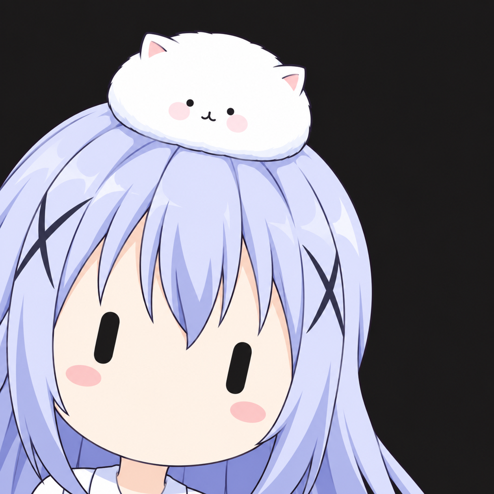
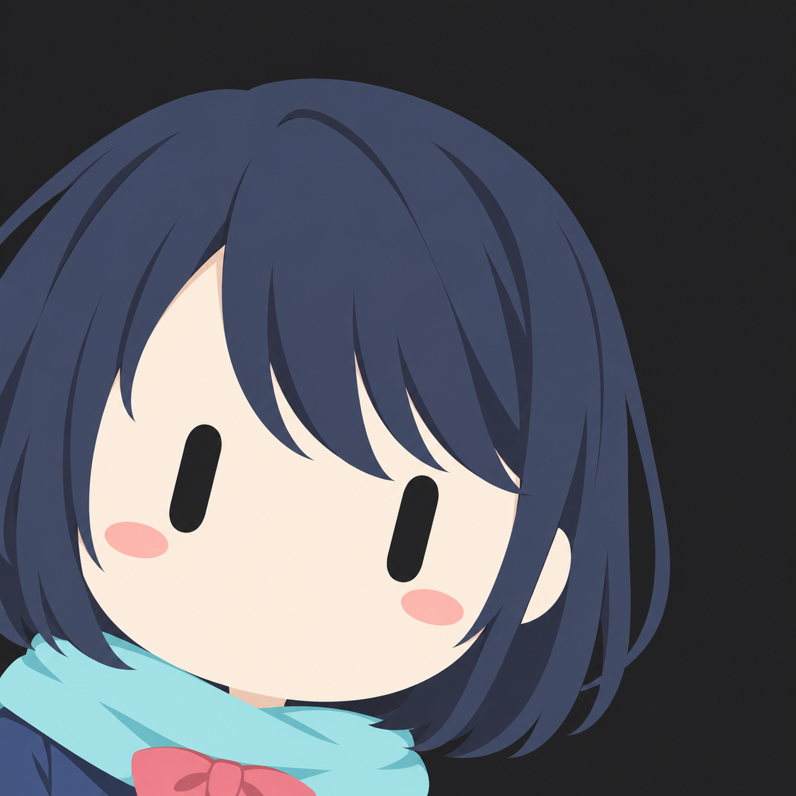
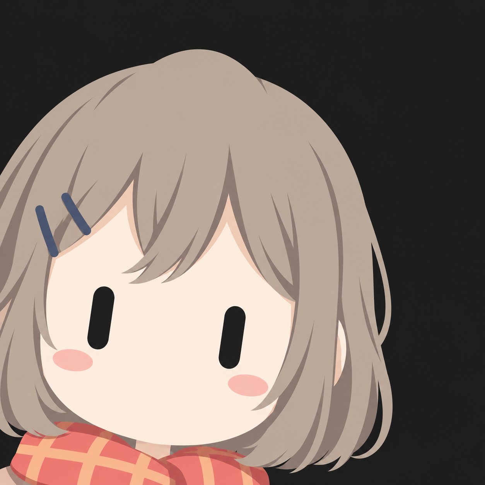
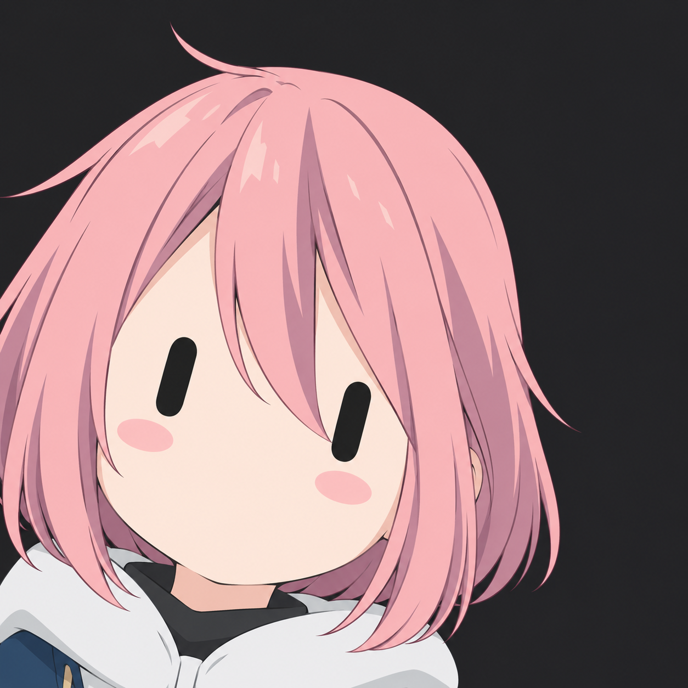
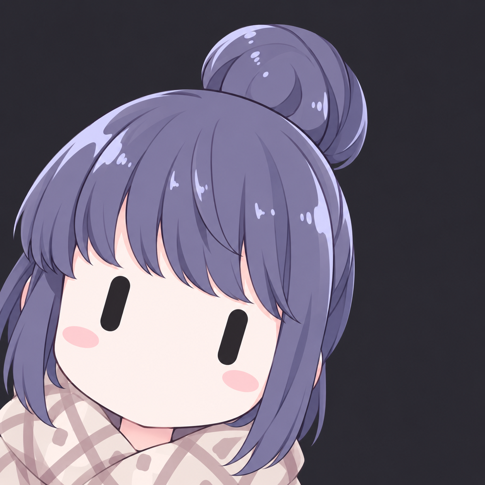

# grokbot-style-icon-skill

A reusable Codex skill for turning a character reference into a minimalist Grokbot-style capsule-eye mascot icon. It captures the composition and visual constraints refined through repeated image-generation feedback, especially the failure-prone face direction, head-roll direction, skin-tone matching, clothing retention, and character-specific hair details.

本仓库提供一个可复用的 Codex Skill：把角色参考图转成极简吉祥物头像。它整理了多轮生成反馈中反复验证的规则，重点约束容易出错的正脸对视、头部倾斜方向、肤色、服装保留和角色专属发型细节。

## Examples / 示例

以下示例展示同一套头像规则如何适配不同发色、发型、配饰和服装。它们用于说明风格，不是每次生成都要照搬的角色设定。

<table>
  <tr>
    <td align="center"><br>白发与猫咪头饰</td>
    <td align="center"><br>深蓝发与青色围巾</td>
    <td align="center"><br>灰棕发与格纹围巾</td>
  </tr>
  <tr>
    <td align="center"><br>粉色短发</td>
    <td align="center"><br>紫发盘发与围巾</td>
    <td></td>
  </tr>
</table>

## Install

Clone this repository into your Codex skills directory. On Windows, the default location is:

```powershell
git clone https://github.com/Qinging-wu/grokbot-style-icon-skill.git "$env:USERPROFILE\.codex\skills\grokbot-style-icon-skill"
```

If `CODEX_HOME` is set, use `$env:CODEX_HOME\skills\grokbot-style-icon-skill` instead. Restart or refresh Codex if the skill does not appear.

## Use

Invoke it explicitly with `$grokbot-style-icon-skill`, or ask naturally, for example:

- “用这张参考图创作 Grokbot 风格头像。”
- “Try this character in the Grokbot capsule-eye icon style.”
- “The blush is too close to the center; move it slightly outward and keep everything else.”

The skill uses an image-generation tool when the host makes one available. Without one, it prepares the prompt but cannot create the bitmap itself.

## Contents

- `SKILL.md`: trigger conditions and compact workflow.
- `references/style-spec.md`: invariant visual rules and high-risk checks.
- `references/reference-analysis.md`: how to identify character traits without mixing references.
- `references/feedback-loop.md`: how to apply narrow revisions while preserving approved results.
- `assets/prompt-template.md`: reusable prompt assembled for the current character.

## Scope and rights

The skill instructions, prompt template, and documentation are released under the MIT License in `LICENSE`. The illustrative images in `assets/examples/` are excluded from that license. Some examples may depict third-party characters; their underlying character designs remain with their respective rights holders. Their inclusion demonstrates the workflow and does not grant permission to reuse those characters or images.

## Contributions

See [CONTRIBUTING.md](CONTRIBUTING.md) for how to propose a general rule or a character-specific correction.
